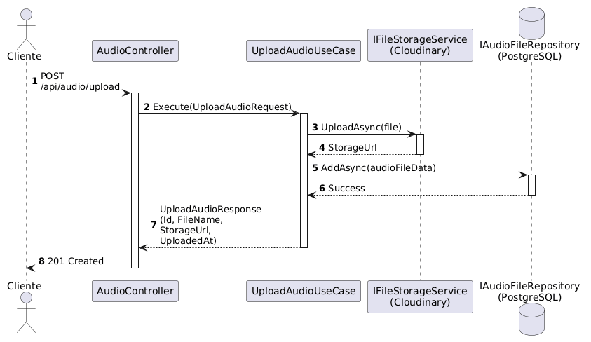

# Capstone — Audio Upload API

API para subir archivos de audio utilizando **Clean Architecture** con **Cloudinary** como file store y **PostgreSQL** como base de datos.

## Stack

| Capa        | Tecnología                                           |
| ----------- | ---------------------------------------------------- |
| Runtime     | .NET 9                                               |
| Arquitectura | Clean Architecture (4 capas)                         |
| API         | ASP.NET Core Web API (Controllers)                   |
| ORM         | Entity Framework Core + Npgsql                       |
| DB          | PostgreSQL                                           |
| File Store  | Cloudinary (CloudinaryDotNet)                        |
| Lenguaje    | C# 13                                                |

## Estructura del proyecto

```
Capstone.sln
src/
├── Capstone.Domain/              => Entidades del negocio puras
├── Capstone.Application/         => Puertos (interfaces) + Casos de uso + DTOs
├── Capstone.Infrastructure/      => Implementaciones concretas (EF Core, Cloudinary)
└── Capstone.Api/                 => Controladores, Middleware, DI, Program.cs
```

### Capstone.Domain
Capa más interna. Contiene solo entidades del dominio sin dependencias externas.
- `Entities/AudioFile.cs` — Entidad con Id, FileName, ContentType, Size, StorageUrl, UploadedAt

### Capstone.Application
Capa de casos de uso. Define **puertos** (interfaces) que la infraestructura implementa.
- `Interfaces/` — Contratos que no dependen de tecnologías externas
- `UseCases/` — Orquestación de la lógica de negocio
- `DTOs/` — Objetos de transferencia de datos

### Capstone.Infrastructure
Capa que implementa los puertos definidos en Application.
- `Persistence/` — EF Core DbContext + Repositories
- `FileStorage/` — Servicio concreto para Cloudinary

### Capstone.Api
Capa de presentación. Depende de Application e Infrastructure.
- `Controllers/` — Endpoints REST
- `Program.cs` — Wiring de dependencias y configuración

## Flujo de subida de audio



## Requisitos

- .NET 9 SDK
- PostgreSQL (local o Docker)
- Cuenta en Cloudinary

## Configuración

Las credenciales se manejan con **User Secrets** en desarrollo:

```bash
dotnet user-secrets init --project src/Capstone.Api
dotnet user-secrets set "Cloudinary:CloudName" "tu-cloud-name"
dotnet user-secrets set "Cloudinary:ApiKey" "tu-api-key"
dotnet user-secrets set "Cloudinary:ApiSecret" "tu-api-secret"
dotnet user-secrets set "ConnectionStrings:DefaultConnection" "Host=localhost;Database=capstone_audio;Username=postgres;Password=tu-pass"
```

## Ejecutar

```bash
dotnet run --project src/Capstone.Api
```

## Endpoints

| Método | Ruta              | Descripción             |
| ------ | ----------------- | ----------------------- |
| POST   | `/api/audio/upload` | Subir archivo de audio |

### POST /api/audio/upload

- **Content-Type:** `multipart/form-data`
- **Body:** campo `file` con el archivo de audio
- **Respuesta 201:**
```json
{
  "id": "uuid",
  "fileName": "cancion.mp3",
  "storageUrl": "https://res.cloudinary.com/...",
  "uploadedAt": "2026-07-10T14:30:00Z"
}
```
- **Respuesta 400:** Archivo inválido o formato no soportado
