# Capstone — Plataforma Distribuida de Procesamiento, Transcripción y Resumen de Audio con IA

Plataforma empresarial orientada a eventos para la **ingesta, validación binaria, compresión de alta fidelidad, transcripción automática con IA (Whisper) y generación de resúmenes semánticos con LLMs (Qwen2.5)**.

El sistema está diseñado bajo los principios de **Clean Architecture (Arquitectura Limpia)** y **Event-Driven Microservices (Arquitectura Orientada a Eventos)**, orquestado mediante **RabbitMQ**, con almacenamiento de objetos S3 compatible (**MinIO**), persistencia relacional (**PostgreSQL 16**) y una interfaz reactiva moderna (**React + TypeScript + Vite**) apoyada en **Web Workers** para concurrencia en cliente.

Los diagramas de arquitectura y flujo se encuentran definidos en código **PlantUML estándar**, disponibles directamente en este documento y como archivos fuente ejecutables en el directorio [`doc/diagrams/`](file:///c:/Users/PC/Documents/jala/progra7/capstone/doc/diagrams).

---

## Tabla de Contenidos

1. [Visión General y Propósito del Sistema](#visión-general-y-propósito-del-sistema)
2. [Stack Tecnológico](#stack-tecnológico)
3. [Arquitectura Global del Sistema](#arquitectura-global-del-sistema)
4. [Diagramas de Flujo del Pipeline de Datos](#diagramas-de-flujo-del-pipeline-de-datos)
   - [Flujo Secuencial Integral (End-to-End)](#flujo-secuencial-integral-end-to-end)
   - [Topología del Message Broker (RabbitMQ)](#topología-del-message-broker-rabbitmq)
   - [Máquina de Estados del Archivo de Audio](#máquina-de-estados-del-archivo-de-audio)
   - [Inspección de Seguridad y Magic Bytes](#inspección-de-seguridad-y-magic-bytes)
   - [Pipeline de Inteligencia Artificial (Whisper + Qwen LLM)](#pipeline-de-inteligencia-artificial-whisper--qwen-llm)
5. [Arquitectura de Software (Clean Architecture)](#arquitectura-de-software-clean-architecture)
6. [Modelo de Datos Relacional (ERD)](#modelo-de-datos-relacional-erd)
7. [Arquitectura del Frontend y Concurrencia](#arquitectura-del-frontend-y-concurrencia)
8. [Streaming y Comparativa de Audio Dual](#streaming-y-comparativa-de-audio-dual)
9. [Especificación de la API REST](#especificación-de-la-api-rest)
10. [Infraestructura y Despliegue con Docker](#infraestructura-y-despliegue-con-docker)
11. [Guía de Ejecución Local y con Contenedores](#guía-de-ejecución-local-y-con-contenedores)
12. [Estrategia de Pruebas y Benchmarking de Rendimiento](#estrategia-de-pruebas-y-benchmarking-de-rendimiento)

---

## Visión General y Propósito del Sistema

El objetivo de este proyecto es solucionar el procesamiento asíncrono y distribuido de medios de audio pesados, evitando cuellos de botella en el servidor web y garantizando:
- **Resiliencia y desacoplamiento**: Cada etapa de procesamiento (validación, compresión, transcripción e inferencia LLM) se ejecuta de forma independiente mediante workers autónomos.
- **Validación rigurosa**: Inspección de cabeceras binarias (*magic numbers*) para impedir la inyección de archivos maliciosos disfrazados de audio.
- **Optimización de ancho de banda y almacenamiento**: Transcodificación automática a **AAC @ 128 kbps**, reduciendo el tamaño original entre un 60% y un 85% sin pérdida perceptible de claridad vocal.
- **Enriquecimiento cognitivo con IA Local**: Transcripción fonética precisa vía **Whisper.net** y generación de resúmenes concisos ejecutando localmente el modelo de lenguaje **Qwen2.5-0.5B-Instruct**, sin enviar datos a APIs de terceros ni incurrir en costes recurrentes de nube.
- **Experiencia de usuario fluida**: El cliente Web delega la subida paralela y el sondeo continuo a un **Web Worker** en segundo plano, y ofrece un reproductor dual comparativo en tiempo real.

---

## Stack Tecnológico

| Capa / Dominio | Componente / Herramienta | Versión / Detalle | Propósito en el Sistema |
| :--- | :--- | :--- | :--- |
| **Backend Core** | .NET Runtime & C# | .NET 8 / C# 12 | Motor principal de API y servicios en background |
| **Patrón Arquitectónico** | Clean Architecture | 4 Capas (Domain, App, Infra, Api) | Desacoplamiento e inversión de dependencias |
| **Broker de Mensajería** | RabbitMQ | 4.0 Management Alpine | Bus de eventos asíncronos y colas topic distribuidas |
| **Base de Datos** | PostgreSQL | 16 Alpine + EF Core 8 + Npgsql | Almacén relacional de metadatos, estados y textos IA |
| **Object Storage** | MinIO | S3-Compatible API | Almacén persistente de audio original y comprimido |
| **Transcodificación** | FFmpeg | 6.x / 7.x CLI | Conversión y compresión a AAC y remuestreo a 16kHz WAV |
| **Motor Speech-to-Text** | Whisper.net | Modelo `ggml-tiny.bin` | Transcripción de voz a texto autónoma en CPU/GPU |
| **Motor LLM (Inferencia)** | LLamaSharp | `qwen2.5-0.5b-instruct-q8_0.gguf` | Resúmenes y síntesis del contenido del audio |
| **Frontend SPA** | React + TypeScript + Vite | React 18, TS 5, Vite 6 | Interfaz interactiva de alta fidelidad con tema claro/oscuro |
| **Concurrencia Web** | Web Worker API | `audioUpload.worker.ts` | Upload multi-hilo en navegador y polling desacoplado |
| **Reverse Proxy** | Nginx | Alpine | Gateway de producción frontend y proxy reverso hacia API |
| **Contenedores** | Docker & Docker Compose | Compose Spec v3.8 | Orquestación completa de los 8 servicios del sistema |
| **Pruebas de Carga** | k6 | Grafana k6 | Pruebas de estrés y límites de latencia bajo carga |

---

## Arquitectura Global del Sistema

Fuente PlantUML: [`doc/diagrams/01_arquitectura_global.puml`](file:///c:/Users/PC/Documents/jala/progra7/capstone/doc/diagrams/01_arquitectura_global.puml)

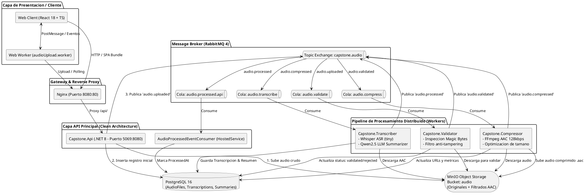

---

## Diagramas de Flujo del Pipeline de Datos

### Flujo Secuencial Integral (End-to-End)

Fuente PlantUML: [`doc/diagrams/02_flujo_secuencial_pipeline.puml`](file:///c:/Users/PC/Documents/jala/progra7/capstone/doc/diagrams/02_flujo_secuencial_pipeline.puml)

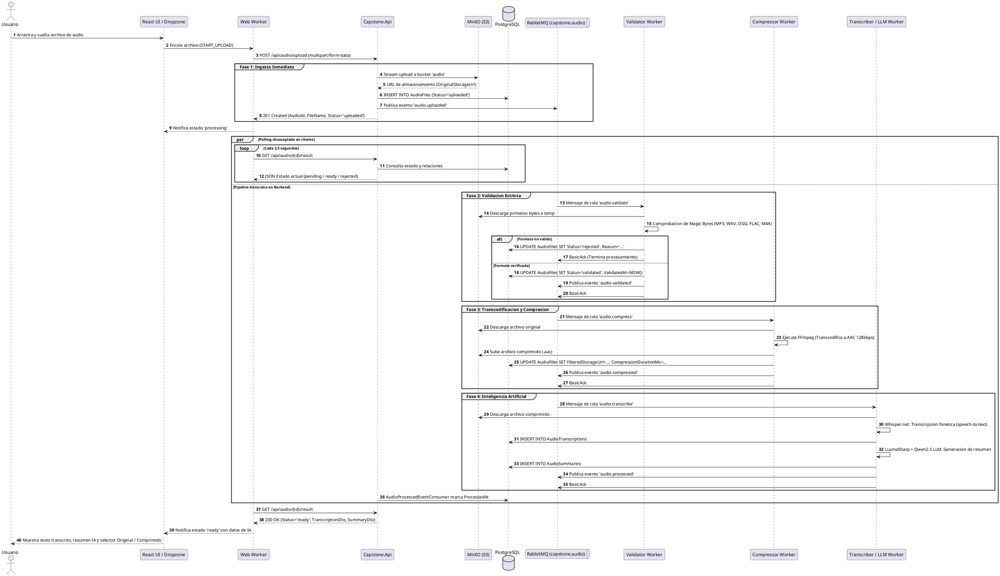

---

### Topología del Message Broker (RabbitMQ)

Fuente PlantUML: [`doc/diagrams/03_topologia_rabbitmq.puml`](file:///c:/Users/PC/Documents/jala/progra7/capstone/doc/diagrams/03_topologia_rabbitmq.puml)

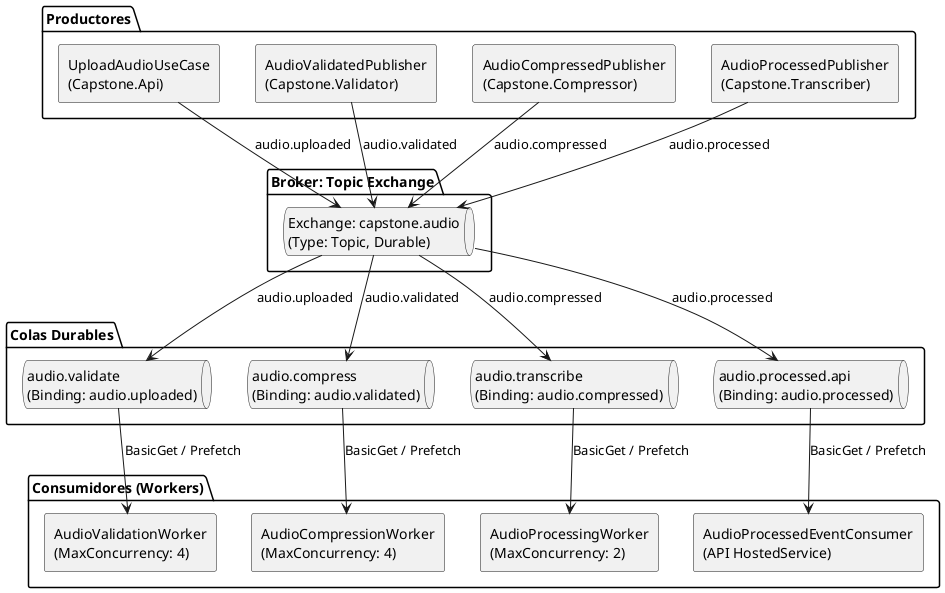

#### Contratos de Mensajería (JSON Payloads)

1. **`audio.uploaded`** y **`audio.validated`**:
```json
{
  "AudioFileId": "c56a4180-65aa-42ec-a945-5fd21dec0538",
  "StorageUrl": "http://minio:9000/audio/c56a4180_conferencia.mp3",
  "FileName": "conferencia.mp3"
}
```

2. **`audio.compressed`**:
```json
{
  "AudioFileId": "c56a4180-65aa-42ec-a945-5fd21dec0538",
  "StorageUrl": "http://minio:9000/audio/c56a4180_conferencia.aac",
  "FileName": "conferencia.aac"
}
```

3. **`audio.processed`**:
```json
{
  "AudioFileId": "c56a4180-65aa-42ec-a945-5fd21dec0538",
  "ProcessedAt": "2026-09-06T14:32:10.123Z"
}
```

---

### Máquina de Estados del Archivo de Audio

Fuente PlantUML: [`doc/diagrams/04_maquina_estados.puml`](file:///c:/Users/PC/Documents/jala/progra7/capstone/doc/diagrams/04_maquina_estados.puml)

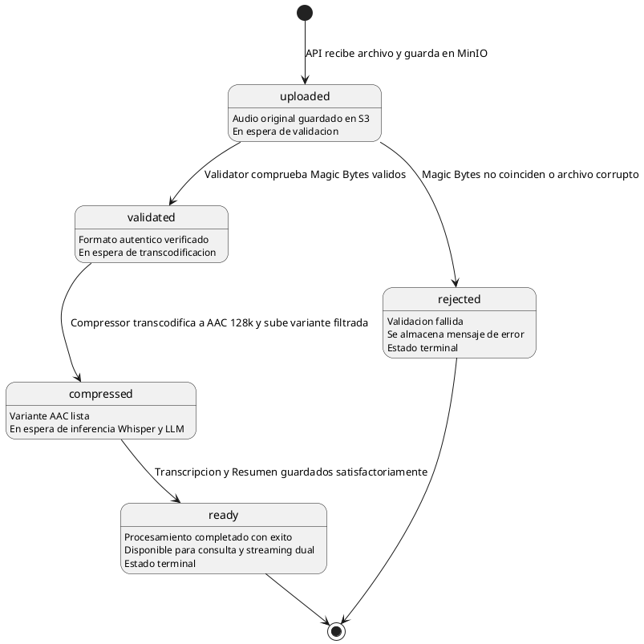

---

### Inspección de Seguridad y Magic Bytes

Fuente PlantUML: [`doc/diagrams/05_inspeccion_magic_bytes.puml`](file:///c:/Users/PC/Documents/jala/progra7/capstone/doc/diagrams/05_inspeccion_magic_bytes.puml)

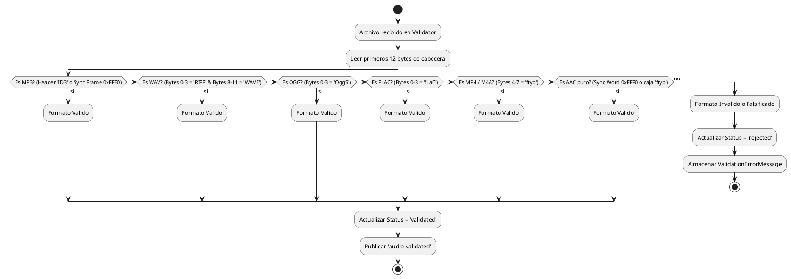

---

### Pipeline de Inteligencia Artificial (Whisper + Qwen LLM)

Fuente PlantUML: [`doc/diagrams/06_pipeline_ia_whisper_qwen.puml`](file:///c:/Users/PC/Documents/jala/progra7/capstone/doc/diagrams/06_pipeline_ia_whisper_qwen.puml)

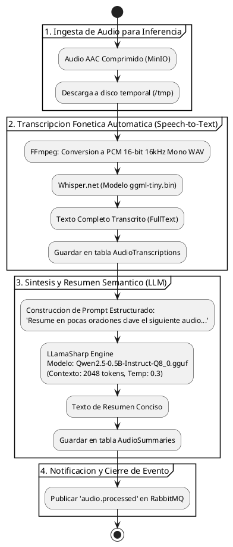

---

## Arquitectura de Software (Clean Architecture)

Fuente PlantUML: [`doc/diagrams/07_clean_architecture.puml`](file:///c:/Users/PC/Documents/jala/progra7/capstone/doc/diagrams/07_clean_architecture.puml)

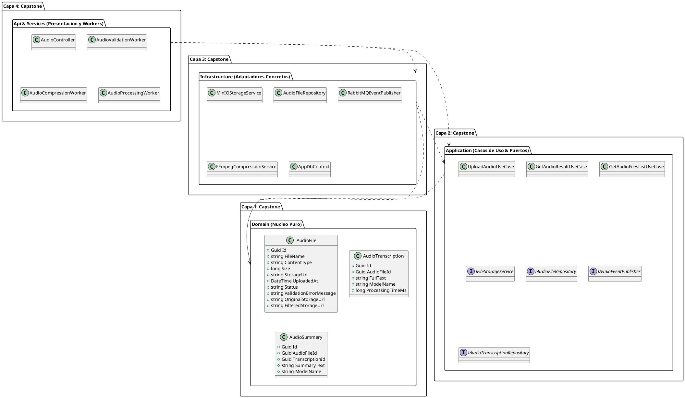

### Estructura de Directorios del Repositorio

```
capstone/
├── src/
│   ├── Capstone.Domain/              # Entidades sin dependencias externas (AudioFile, AudioTranscription, etc.)
│   ├── Capstone.Application/         # Casos de uso, interfaces/puertos y DTOs
│   ├── Capstone.Infrastructure/      # Implementación de MinIO, PostgreSQL/EF Core, RabbitMQ, FFmpeg
│   └── Capstone.Api/                 # ASP.NET Core Web API, Middleware, Swagger, Endpoints
├── services/
│   ├── Capstone.Validator/           # Worker de validación de Magic Bytes
│   ├── Capstone.Compressor/          # Worker de compresión a AAC 128kbps
│   └── Capstone.Transcriber/         # Worker de transcripción Whisper y resumen Qwen LLM
├── web/                              # SPA React + TypeScript + Vite + Nginx
│   ├── src/
│   │   ├── components/               # AudioList, FileDropzone, AudioPreviewBar (dual player), etc.
│   │   ├── workers/                  # audioUpload.worker.ts (Web Worker multihilo)
│   │   └── services/                 # Llamadas HTTP tipadas
├── doc/
│   └── diagrams/                     # Fuentes .puml estándar de todos los diagramas del sistema
├── k6/                               # Scripts de prueba de carga y benchmarking con k6
├── tests/
│   └── Capstone.Tests/               # Pruebas unitarias de casos de uso y servicios
├── docker-compose.yml                # Orquestación de los 8 contenedores
└── README.md                         # Documentación integral de arquitectura
```

---

## Modelo de Datos Relacional (ERD)

Fuente PlantUML: [`doc/diagrams/08_modelo_datos_erd.puml`](file:///c:/Users/PC/Documents/jala/progra7/capstone/doc/diagrams/08_modelo_datos_erd.puml)

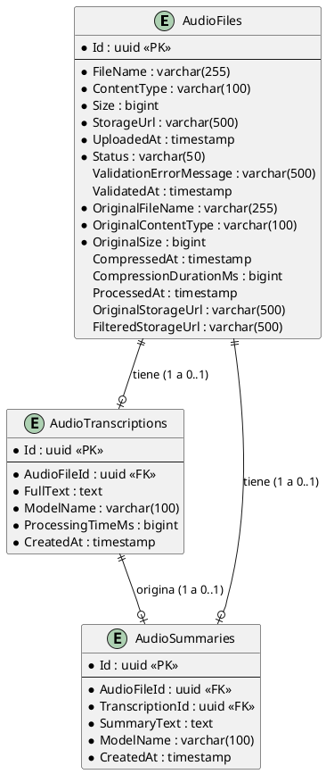

---

## Arquitectura del Frontend y Concurrencia

Fuente PlantUML: [`doc/diagrams/09_frontend_concurrencia.puml`](file:///c:/Users/PC/Documents/jala/progra7/capstone/doc/diagrams/09_frontend_concurrencia.puml)

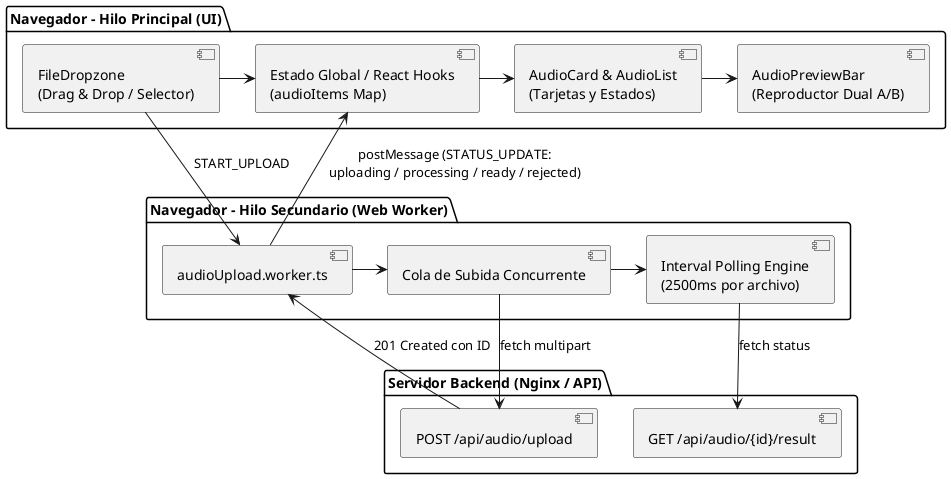

---

## Streaming y Comparativa de Audio Dual

Fuente PlantUML: [`doc/diagrams/10_streaming_dual.puml`](file:///c:/Users/PC/Documents/jala/progra7/capstone/doc/diagrams/10_streaming_dual.puml)

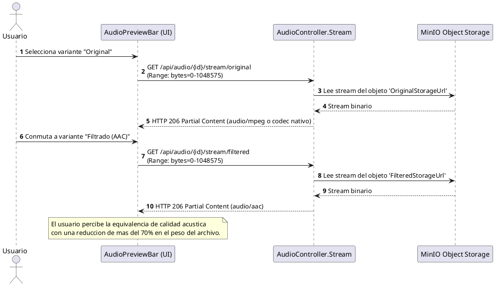

---

## Especificación de la API REST

Base URL en desarrollo local: `http://localhost:5069`  
Base URL a través de Nginx (Docker): `http://localhost:8080`  
Documentación interactiva Swagger: `http://localhost:5069/swagger`

| Método | Endpoint | Parámetros / Body | Códigos HTTP | Descripción |
| :--- | :--- | :--- | :--- | :--- |
| `POST` | `/api/audio/upload` | Form-data `file` (Hasta 50 MB) | `201`, `400`, `413` | Sube archivo, almacena en MinIO y encola validación |
| `GET` | `/api/audio/{id}/result` | Path: `id` (UUID) | `200`, `400`, `404` | Obtiene el estado (`pending`, `ready`, `rejected`), transcripción y resumen |
| `GET` | `/api/audio` | Ninguno | `200` | Lista todos los audios procesados o en cola |
| `GET` | `/api/audio/{id}/stream/original` | Path: `id` (UUID), Soporta Range | `200`, `206`, `404` | Streaming de la variante de audio original |
| `GET` | `/api/audio/{id}/stream/filtered` | Path: `id` (UUID), Soporta Range | `200`, `206`, `404` | Streaming de la variante comprimida a AAC |

---

## Infraestructura y Despliegue con Docker

Fuente PlantUML: [`doc/diagrams/11_infraestructura_docker.puml`](file:///c:/Users/PC/Documents/jala/progra7/capstone/doc/diagrams/11_infraestructura_docker.puml)

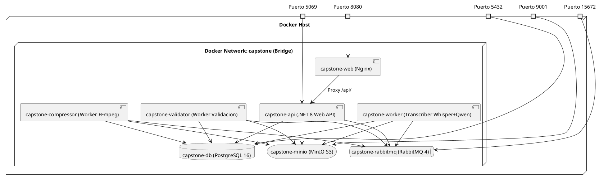

### Puertos y Credenciales por Defecto

| Servicio | Puerto Host | Puerto Contenedor | Credenciales / Acceso |
| :--- | :--- | :--- | :--- |
| **Frontend Web (Nginx)** | `8080` | `80` | `http://localhost:8080` |
| **API REST (.NET)** | `5069` | `8080` | `http://localhost:5069/swagger` |
| **RabbitMQ Management** | `15672` | `15672` | `http://localhost:15672` (guest / guest) |
| **RabbitMQ AMQP** | `5672` | `5672` | Protocolo AMQP para los workers |
| **MinIO Console** | `9001` | `9001` | `http://localhost:9001` (minioadmin / minioadmin) |
| **MinIO S3 API** | `9000` | `9000` | Endpoint S3 para API y Workers |
| **PostgreSQL** | `5432` | `5432` | `postgres` / `postgres` (DB: `capstone_audio`) |

---

## Guía de Ejecución Local y con Contenedores

### Requisitos Previos
- [Docker](https://www.docker.com/) & Docker Compose v2+
- [.NET 8 SDK](https://dotnet.microsoft.com/) (si se ejecuta fuera de Docker)
- [Node.js 20+](https://nodejs.org/) y [pnpm](https://pnpm.io/) (para desarrollo web local)
- [FFmpeg](https://ffmpeg.org/) instalado y disponible en PATH (solo para desarrollo sin Docker)
- Archivos de modelos IA en `services/Capstone.Transcriber/models/`:
  - `ggml-tiny.bin` (Whisper ASR)
  - `qwen2.5-0.5b-instruct-q8_0.gguf` (LLM de Resúmenes)

---

### Opción A: Despliegue Completo con Docker (Recomendado)

1. **Clonar el repositorio y situarse en la raíz:**
   ```bash
   cd capstone
   ```

2. **Verificar los modelos de IA:**
   Asegúrese de que la carpeta `services/Capstone.Transcriber/models/` contiene:
   - `ggml-tiny.bin`
   - `qwen2.5-0.5b-instruct-q8_0.gguf`

3. **Construir y levantar todos los servicios:**
   ```bash
   docker compose up -d --build
   ```

4. **Verificar el estado de los contenedores:**
   ```bash
   docker compose ps
   ```

5. **Acceder a las aplicaciones:**
   - **Aplicación Web**: [http://localhost:8080](http://localhost:8080)
   - **Documentación Swagger API**: [http://localhost:5069/swagger](http://localhost:5069/swagger)
   - **Consola RabbitMQ**: [http://localhost:15672](http://localhost:15672) (User: `guest`, Pass: `guest`)
   - **Consola MinIO**: [http://localhost:9001](http://localhost:9001) (User: `minioadmin`, Pass: `minioadmin`)

---

### Opción B: Ejecución en Entorno de Desarrollo Híbrido

Si desea depurar el código de la API o de un worker en Visual Studio / VS Code mientras los servicios auxiliares corren en Docker:

1. **Levantar solo la infraestructura de soporte:**
   ```bash
   docker compose up -d postgres minio rabbitmq
   ```

2. **Configurar el archivo `.env`:**
   Copiar `.env.example` a `.env` en la raíz y configurar `HOST_IP=localhost`.

3. **Ejecutar la API:**
   ```bash
   dotnet run --project src/Capstone.Api
   ```

4. **Ejecutar los Workers (en terminales separadas):**
   ```bash
   dotnet run --project services/Capstone.Validator
   dotnet run --project services/Capstone.Compressor
   dotnet run --project services/Capstone.Transcriber
   ```

5. **Ejecutar el Frontend Web:**
   ```bash
   cd web
   pnpm install
   pnpm dev
   ```
   Acceder a `http://localhost:5173`.

---

## Estrategia de Pruebas y Benchmarking de Rendimiento

### 1. Pruebas Unitarias e Integración (.NET)

La suite de pruebas con **xUnit** y **Moq** cubre:
- Casos de uso de subida y consulta (`UploadAudioUseCase`, `GetAudioResultUseCase`, `GetAudioFilesListUseCase`).
- Detección y compresión con FFmpeg (`FFmpegCompressionServiceTests`).
- Concurrencia de workers y límites de hilos (`AudioProcessingWorkerConcurrencyTests`).
- Serialización y publicación de eventos RabbitMQ (`AudioProcessedPublisherTests`).

Para ejecutar todas las pruebas:
```bash
dotnet test tests/Capstone.Tests
```

---

### 2. Pruebas de Rendimiento y Carga con k6

El proyecto incluye un script de benchmarking en `k6/upload-audio.js` configurado con etapas de estrés incremental:
- **Etapa 1**: 5 usuarios virtuales (15s).
- **Etapa 2**: 10 usuarios virtuales simultáneos (30s).
- **Etapa 3**: Pico de 25 usuarios virtuales (15s).
- **Etapa 4**: Enfriamiento a 0 usuarios (15s).

**Métricas y Umbrales Evaluados:**
- Latencia percentil 95: `p(95) < 10000 ms`.
- Tasa de éxito de subida: `rate > 95%`.
- Tasa de fallos HTTP: `rate < 5%`.

Para ejecutar el benchmark:
```bash
k6 run k6/upload-audio.js
```
